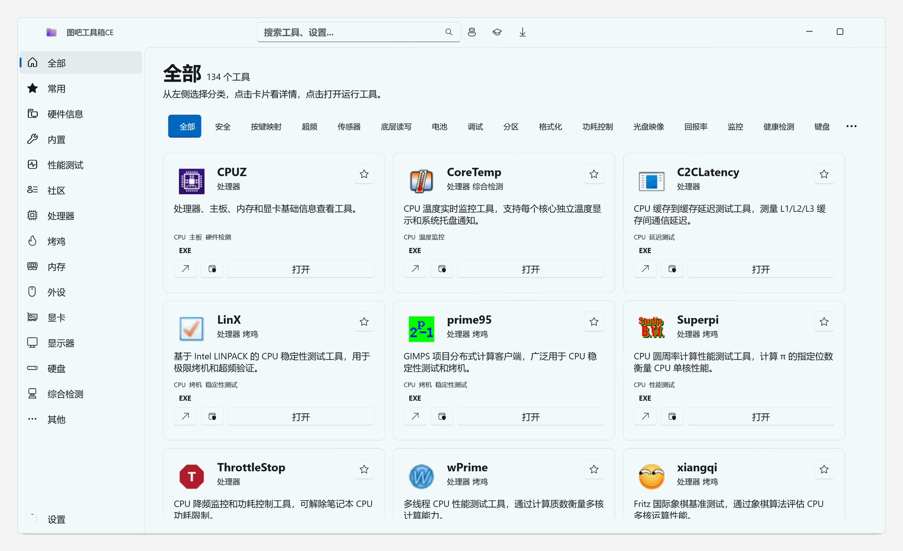
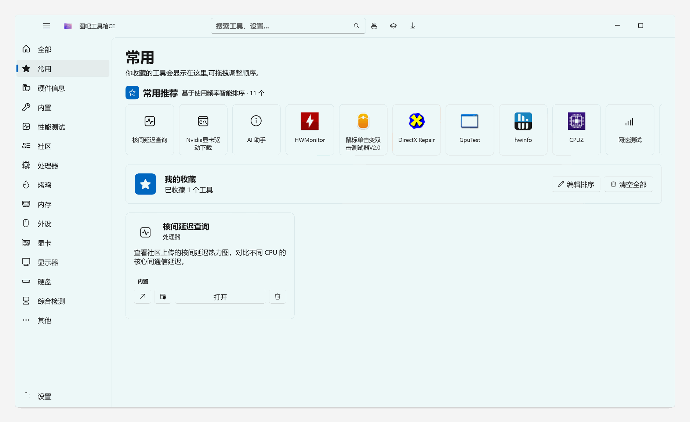
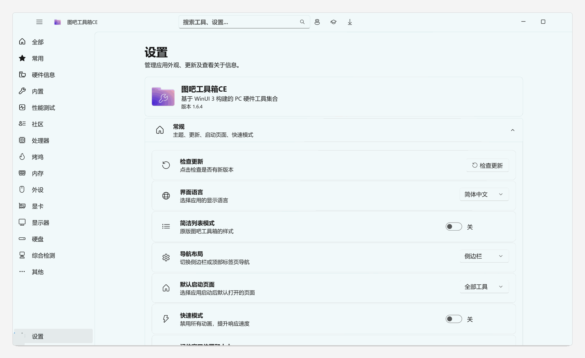
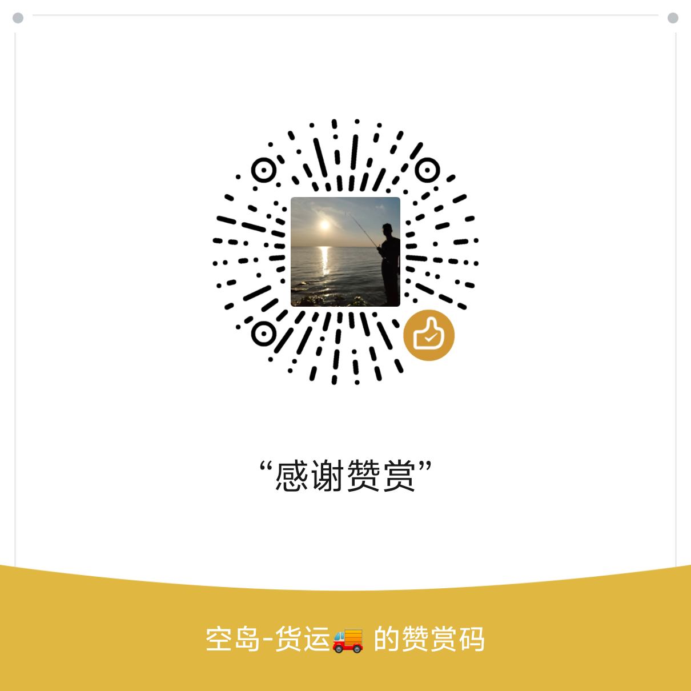

[English](README_EN.md) | 中文

# 空岛图吧工具箱

 

**一台新电脑从验机、跑分、装驱动到日常清理维护，只用这一个工具箱。**

89 款经典硬件工具随包收录，47 款 Fluent 原生工具开箱即用，还住着一个能直接操作你电脑的 AI 助手。

[官网文档](https://kongdaokeji.top) | [下载](https://github.com/kongdaokeji/kongdao-toolbox/releases) | [反馈](https://github.com/kongdaokeji/kongdao-toolbox/issues) | [讨论](https://github.com/kongdaokeji/kongdao-toolbox/discussions)

> 本仓库是 [luolangaga/tubatools](https://github.com/luolangaga/tubatools)（GPL-3.0）的空岛科技二次开发版，遵循 GPL-3.0 开源分发，原作者署名与协议权利全部保留。

> [!WARNING]
> 近期有许多非官方下载渠道，请注意甄别风险！请仅通过官方文档「[安装](guide/getting-started.md#安装)」列出的官方渠道下载。

---

## 项目介绍

  
  

左侧导航按分类浏览全部工具，顶部一个搜索框能搜到任何一款工具，觉得好用就点星标收进常用页。
**收录的 89 款经典工具 + 内置的 47 款原生工具，共用同一套卡片、收藏、排序与桌面快捷方式**——用起来没有「两套东西」的感觉。

* **AI 助手** —— 内置智能系统代理：读硬件、分析磁盘、清理垃圾、读写文件、执行命令、联网搜索，28 个 Agent 工具 + 危险操作确认
* **硬件检测与性能** —— 温度 / 频率 / 功耗实时曲线、一键三烤、毒蘑菇测试、跑分排行、快速验机、磁盘健康
* **格式转换** —— 图片 / 音视频 / Word / Excel / PPT / PDF 互转，OCR 识别、PDF 合并拆分、批量队列
* **游戏工具箱** —— 可自定义布局的 FPS / 温度 / 负载悬浮层，虚拟局域网一键联机，运行库一键修复
* **系统优化与安全** —— 垃圾清理 / 启动项管理 / 右键菜单管理 / 恶意软件拦截 / 沙盒分析 / 时间同步
* **网络工具** —— 网速测试 / 流量监控 / 端口占用 / Hosts 编辑 / 局域网文件分享
* **原生 Fluent 体验** —— Mica 材质、亮暗主题、中英双语、全局搜索、收藏拖拽排序

### 文档导航

| 文档 | 内容 |
|:-----|:-----|
| [功能详解](guide/features.md) | AI 助手、硬件检测与性能、游戏、系统优化、网络、格式转换、实用工具 |
| [内置工具（47 款）](guide/builtin-tools.md) | 原生 Fluent 工具完整清单 |
| [收录工具（89 款）](guide/bundled-tools.md) | 随包第三方工具分类清单 |
| [快速开始](guide/getting-started.md) | 系统要求、安装方式（Releases / Winget / Scoop / Store）、从源码构建 |
| [架构](guide/architecture.md) | 目录结构、模块说明与实现细节 |
| [常见问题](guide/faq.md) | UAC、杀毒误报、便携使用、日志位置等 |
| [交流与链接](guide/community.md) | QQ 群、贡献者、相关链接、项目数据 |

---

## 来源与致谢

* 本项目基于开源项目 [luolangaga/tubatools](https://github.com/luolangaga/tubatools)（GPL-3.0）二次开发，原作者 **luolangaga**，特此致谢。
* 上游项目曾获 AtomGit G-Star 毕业认证、HelloGitHub 收录推荐、Trendshift 登榜等荣誉，相关权利归原作者所有。
* 本衍生版遵循 GPL-3.0 协议开源分发，保留原作者全部署名权利；程序内「设置 → 关于 → 署名」处同样保留上游项目署名。

---

## Code signing policy

> Free code signing provided by [SignPath.io](https://about.signpath.io), certificate by [SignPath Foundation](https://signpath.org).

由 [SignPath.io](https://about.signpath.io) 提供免费代码签名，证书由 [SignPath Foundation](https://signpath.org) 颁发。签名在自动化构建流程中完成，因此签名代表该二进制是由本仓库源码自动构建产生的 —— 构建须通过可信构建系统（GitHub Actions）校验来源，并经 Approver 人工批准后才会签名。

- **Committers / Reviewers**: [@kongdaokeji](https://github.com/kongdaokeji)
- **Approvers**: [@kongdaokeji](https://github.com/kongdaokeji)
- **隐私政策 / Privacy policy**: [PrivacyPolicy.txt](PrivacyPolicy.txt)

---

## 许可证

本项目采用 **GPL-3.0** 开源协议。

- 源代码可自由使用、修改和分发
- 衍生作品必须以相同协议开源
- 详见 [LICENSE](LICENSE)；附带的 [License.txt](License.txt) 为软件使用须知与网络/隐私声明，不构成对 GPL-3.0 的附加限制

---

## 赞赏支持

如果这个工具箱对你有帮助，欢迎请空岛喝杯奶茶 ☕ 你的支持是我们持续维护的动力，感谢每一位支持者！

---

<a href="https://star-history.com/#kongdaokeji/kongdao-toolbox&type=date&legend=bottom-right">
  <picture>
    <source media="(prefers-color-scheme: dark)" srcset="https://api.star-history.com/svg?repos=kongdaokeji/kongdao-toolbox&type=date&theme=dark&legend=bottom-right" />
    <source media="(prefers-color-scheme: light)" srcset="https://api.star-history.com/svg?repos=kongdaokeji/kongdao-toolbox&type=date&legend=bottom-right" />
    
  </picture>
</a>

**如果觉得有用，给个 Star 吧！**

WinUI 3 · .NET 10 · Windows App SDK · GPL-3.0 · [许可证](LICENSE)

