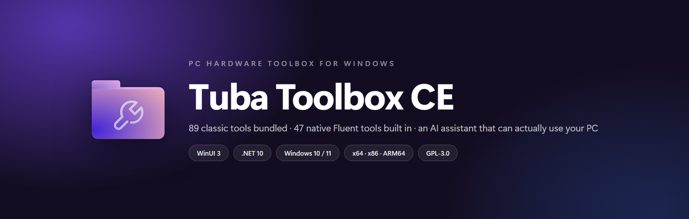

English | [中文](README.md)

Note: this English README is translated by AI and may contain inaccuracies.

 

**One toolbox for a new PC — from first-boot checks and benchmarks to drivers, cleanup and repair.**

89 classic hardware tools ship in the box, 47 native Fluent tools work out of the box, and an AI assistant lives inside that can actually operate your PC.

[Official Docs](https://kongdaokeji.top) | [Download](https://github.com/kongdaokeji/kongdao-toolbox/releases) | [Issues](https://github.com/kongdaokeji/kongdao-toolbox/issues) | [Discussions](https://github.com/kongdaokeji/kongdao-toolbox/discussions)

> This repository is Kongdao Technology's derivative work based on the open-source project [luolangaga/tubatools](https://github.com/luolangaga/tubatools) (GPL-3.0), distributed under GPL-3.0 with all original author credits and license rights preserved.

> [!WARNING]
> There have been many unofficial download channels lately — please verify before downloading! Only use the official channels listed under [Installation](guide/en/getting-started.md#installation).

---

## About

  
  

The left navigation browses every tool by category, the search box at the top finds any of them, and a star puts the ones you like on the favorites page.
**The 89 bundled classic tools and the 47 built-in native tools share one card layout, one favorites list, one sort order and one desktop-shortcut path** — so it never feels like two separate products.

* **AI Assistant** — a built-in system agent: reads hardware info, analyzes disk usage, cleans junk, reads/writes files, runs commands and searches the web, with 28 agent tools and confirmation for risky actions
* **Hardware Detection & Performance** — live temperature / frequency / power curves, stress tests, fractal GPU test, benchmark leaderboards, new-PC check and disk health
* **Format Converter** — images / audio & video / Word / Excel / PPT / PDF conversion, OCR, PDF merge & split and batch queues
* **Gaming Toolbox** — a customizable FPS / temperature / load overlay, one-click virtual LAN co-op, and runtime repair
* **System Optimization & Security** — junk cleaner / startup manager / context menu manager / malware blocker / sandbox analysis / time sync
* **Network Tools** — speed test / traffic monitor / port viewer / hosts editor / LAN file sharing
* **Native Fluent Experience** — Mica material, light & dark themes, English and Chinese UI, global search, drag-to-reorder favorites

### Documentation

| Document | Contents |
|:---------|:---------|
| [Features](guide/en/features.md) | AI Assistant, hardware detection & performance, gaming, system optimization, network, format conversion, utilities |
| [Built-in Tools (47)](guide/en/builtin-tools.md) | The complete native Fluent tool list |
| [Bundled Tools (89)](guide/en/bundled-tools.md) | Third-party tools that ship with the app, by category |
| [Getting Started](guide/en/getting-started.md) | System requirements, installation (Releases / Winget / Scoop / Store), building from source |
| [Architecture](guide/en/architecture.md) | Directory layout, module notes and implementation details |
| [FAQ](guide/en/faq.md) | UAC, antivirus flags, portable use, log locations and more |
| [Community & Links](guide/en/community.md) | QQ group, contributors, links and project analytics |

---

## Credits & Acknowledgements

* This project is a derivative work of the open-source project [luolangaga/tubatools](https://github.com/luolangaga/tubatools) (GPL-3.0), originally created by **luolangaga**. Sincere thanks to the original author.
* The upstream project earned honors including AtomGit G-Star graduation, a HelloGitHub recommendation, and Trendshift listings; all such rights belong to the original author.
* This derivative is distributed under GPL-3.0 and preserves all original author credits; the upstream project credit also remains in-app under Settings → About → Credits.

---

## Code signing policy

> Free code signing provided by [SignPath.io](https://about.signpath.io), certificate by [SignPath Foundation](https://signpath.org).

Signing happens inside the automated build pipeline, so a signature means the binary is an automated build of this repository's source: the build must pass trusted build system (GitHub Actions) origin verification and be manually approved by an Approver before it is signed.

- **Committers / Reviewers**: [@kongdaokeji](https://github.com/kongdaokeji)
- **Approvers**: [@kongdaokeji](https://github.com/kongdaokeji)
- **Privacy policy**: [PrivacyPolicy.txt](PrivacyPolicy.txt)

---

## Donate

If this toolbox has been useful to you, you're welcome to buy me a milk tea ☕ — thank you to everyone who supports it!

---

<a href="https://star-history.com/#kongdaokeji/kongdao-toolbox&type=date&legend=bottom-right">
  <picture>
    <source media="(prefers-color-scheme: dark)" srcset="https://api.star-history.com/svg?repos=kongdaokeji/kongdao-toolbox&type=date&theme=dark&legend=bottom-right" />
    <source media="(prefers-color-scheme: light)" srcset="https://api.star-history.com/svg?repos=kongdaokeji/kongdao-toolbox&type=date&legend=bottom-right" />
    
  </picture>
</a>

**If you find this useful, please give it a star!**

WinUI 3 · .NET 10 · Windows App SDK · GPL-3.0 · [License](LICENSE)

